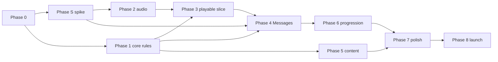

# Implementation outline

The plan in more detail, phase by phase. [PLAN.md](../PLAN.md) is the overview as first written;
[DECISIONS.md](../DECISIONS.md) records what the review changed; the documents here say what to build,
in what order, and how to tell it is done. The specs in [../specs/](../specs/) hold the exact rules.

## Where things stand

| Phase | Document | Status |
| --- | --- | --- |
| 0 Foundations | Below | Done except the owner's steps |
| S Device spike | [phase-s-device-spike.md](phase-s-device-spike.md) | Outlined; needs the spike build, then devices |
| 1 Core rules | [phase-1-core-rules.md](phase-1-core-rules.md) | Outlined to file level; ready to start |
| 2 Audio and clock | [phase-2-audio-clock.md](phase-2-audio-clock.md) | Outlined; starts after spike S1 |
| 3 to 8 | [phases-3-to-8.md](phases-3-to-8.md) | Outlined at task level; detailed when reached |

Phase 1 and the device spike do not depend on each other, so they run in parallel: Phase 1 needs no
Mac or device, and the spike needs only a small throwaway build.

## Phase 0: foundations

| Task | Status |
| --- | --- |
| P0.2 Repository, `project.yml`, app stub, Messages extension, `RiffCore` package, tests | Done. CI generates the project and builds it for the simulator on a macOS runner |
| P0.3 README, formatter config, one script that runs every check | Done (`scripts/check.sh`) |
| Icon set with every slot filled, privacy manifest, export-compliance flag | Done with placeholders (D-028) |
| P0.1 Bundle id prefix and Team ID in `Config/Local.xcconfig` | **Owner** |
| App Store Connect record; first TestFlight build | **Owner**, before Phase S |
| Run the Riff scheme on your iPhone and open it in Messages | **Owner**: this is the half of the Phase 0 gate CI cannot check |

## What happens next

1. **Finish the review** (D-082): the build/architecture and content/UX/legal areas, and the skeptic
   pass on the gameplay, match and audio findings. Until then the specs are marked draft 1.
2. **Phase 1, task P1.0**: bring `GameConfig` in line with the decisions, then the engine.
3. **Spike build** for Phase S, in parallel, so it is ready when the devices are.
4. **Owner decisions** in the table at the top of DECISIONS.md. None blocks work today: each has a
   default, and each is one configuration value. Music sourcing (D-101) has the longest lead time.

## How each phase document is organised

Rules that are specific to the phase, a task table (what, which files, which tests), the order of
work, what it needs from the owner, and a "Done when" gate that can be checked objectively. A phase is
not finished until its gate passes; the next phase does not build on it before then.

## Conventions for the work

- Each task lands as one or a few commits with its tests, and `scripts/check.sh` passing.
- After each task: what changed, which files, how to verify it, and what is needed from the owner.
- Anything a device must confirm is added to the spike document, not assumed.
- A decision made along the way is logged in DECISIONS.md with its reason.
