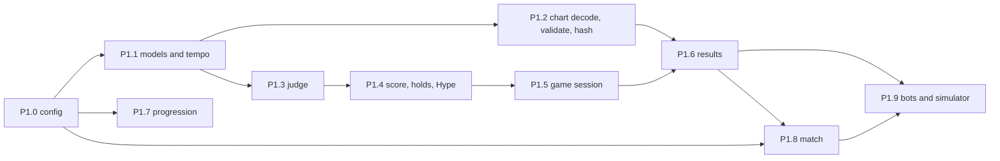

# Phase 1: core rules (RiffCore)

Every rule that decides a score, a turn or a level, as a pure Swift package with tests. Nothing in
this phase needs a Mac or a device: it builds and tests on Linux (`scripts/test-core.sh`) and on
macOS in CI.

Specs: [GAME_RULES.md](../specs/GAME_RULES.md), [MATCH_PROTOCOL.md](../specs/MATCH_PROTOCOL.md),
[CHART_FORMAT.md](../specs/CHART_FORMAT.md). Where a task and a spec disagree, fix the spec first.

## Order of work

P1.7 can run alongside the engine tasks. P1.8 needs only the score ceiling from P1.6, through a small
lookup protocol, so most of it can also run alongside.

All paths below are under `Packages/RiffCore/Sources/RiffCore/` unless they start with `Tests/` or
`riffcli/`.

## P1.0 Apply the decided values

**Done.** The scaffold's `GameConfig` held PLAN.md revision 1 values. (D-080)

- Apply the tables "GameConfig changes required" in GAME_RULES.md section 12 and MATCH_PROTOCOL.md
  section 15.
- Add `rulesVersion = 1` and `Tests/.../RulesVersionTests.swift`: a digest of the scoring-relevant
  values is pinned to the version, so changing a value without bumping it fails. The digest needs
  `Crypto/SHA256.swift`, so that file and its tests land here, not in P1.2. (D-085)
- Run `scripts/sync-config-snapshot.sh`; update `tools/tests` for the changed values.
- Add `scripts/coverage-core.sh` (line coverage per file for `Sources/RiffCore`, fails under a
  threshold); the phase gate uses it.

**Done when:** `scripts/check.sh` passes and the snapshot is committed.

## P1.1 Models and the tempo map

| File | Contents |
| --- | --- |
| `Model/Chart.swift` | `Chart`, `Note` (tick, lane, length), `HypePhrase`, `TempoSegment` (tick, mbpm), `ChartComputed` |
| `Model/SongManifest.swift` | The manifest in CHART_FORMAT.md section 5 |
| `Chart/TempoMap.swift` | `time(ofTick:)`, `tick(atTime:)`, segment starts (GAME_RULES 1.1) |
| `Chart/CompiledChart.swift` | Notes with precomputed times, miss deadlines, hold ends, phrase membership |

Tests: conversion round trips at segment boundaries; a two-tempo map checked against hand-computed
microseconds; negative time; `Int64` headroom at 400 BPM and 2 minutes.

## P1.2 Chart decoding, validation and hash

| File | Contents |
| --- | --- |
| `Chart/ChartDecoder.swift` | Strict JSON decode; rejects unknown format or version |
| `Chart/ChartValidator.swift` | Every rule in CHART_FORMAT.md section 4, returning a list of issues with tick and lane |
| `Crypto/HMACSHA256.swift` | Pure Swift (no CryptoKit on Linux), built on the `Crypto/SHA256.swift` from P1.0. Tested with the published RFC 4231 vectors; on Apple platforms a test compares against CryptoKit |
| `Chart/ChartHash.swift` | The canonical string and hash (CHART_FORMAT.md section 2) |
| `riffcli/Commands/ChartCommand.swift` | `riffcli chart check <file>` and `riffcli chart compute <file>` |

Tests: one failing fixture per validation rule; a passing example chart under
`Tests/RiffCoreTests/Fixtures/`; hash stability; the hash ignores `sections` and changes with any
note.

## P1.3 Judge

`Engine/Judge.swift`: windows per difficulty, earliest-unjudged matching per lane, miss deadlines,
ghost-tap classification and bounce grace (GAME_RULES section 3).

Tests: window edges at exact microseconds; Easy scaling; a skipped note at the minimum same-lane gap;
chords judged independently; every ghost-tap exemption.

## P1.4 Score, holds and Hype

| File | Contents |
| --- | --- |
| `Engine/ScoreKeeper.swift` | Streak, multiplier, note points, the sustain accumulator `U` |
| `Engine/HoldTracker.swift` | Rules H1 to H6: ownership, live interval in ticks, release |
| `Engine/HypeMeter.swift` | Rules R1 to R6 in integer ticks |

Tests: one per rule; multiplier change in the middle of a hold; the single floor; extension while
active; a touch at exactly the expiry time.

## P1.5 Game session

| File | Contents |
| --- | --- |
| `Engine/InputEvent.swift`, `Engine/OutputEvent.swift` | The two event vocabularies (GAME_RULES section 2) |
| `Engine/GameSession.swift` | `apply`, `advance(to:)`, the scheduled-event queue and its total order; states ready, lead-in, playing, paused, finished |
| `Engine/RunLog.swift` | The replayable input log: events plus chart hash, rules version, difficulty |

Tests: the partition-invariance property test; late input clamping; pause sends releases; finality.

## P1.6 Results

`Results/RunSummary.swift`, `Results/Accuracy.swift`, `Results/StarRating.swift`,
`Results/PerfectRun.swift` (base score, ceiling, star cut-offs), wired into `riffcli chart compute`.

Tests: accuracy rounding; star boundaries in integers; Gold; the perfect-run bot equals the stored
base score of the example chart.

## P1.7 Progression

| File | Contents |
| --- | --- |
| `Progression/XPRules.swift` | One integer formula: events summed, then streak, featured and practice percentages with one floor (D-072) |
| `Progression/DailyStreak.swift` | UTC time, local day, high-water mark, travel grace (D-073) |
| `Progression/FeaturedRotation.swift` | Week index from the fixed Monday 2026-01-05 UTC over an explicit schedule (D-074) |
| `Progression/Unlocks.swift` | The level-to-reward table loaded from `progression.json`; defaults outside the counts (D-075) |
| `Progression/Profile.swift` | Merge-safe profile: XP as a per-install counter, unlocks as a grow-only set, level derived (D-070) |

Tests: the XP table as golden cases including a typical duel turn; year boundaries 2026/27 and
2027/28; clock set backwards and forwards; eastward travel; every level has a defined reward or is
deliberately empty.

## P1.8 Match

| File | Contents |
| --- | --- |
| `Match/MatchState.swift`, `Match/Entry.swift`, `Match/Nickname.swift` | The model and nickname rules |
| `Match/MatchMerge.swift` | Section 4 of the protocol |
| `Match/Finality.swift`, `Match/Ranking.swift` | Sections 5 and 6 |
| `Match/PayloadCodec.swift`, `Support/ByteWriter.swift`, `Support/ByteReader.swift`, `Support/Base64URL.swift` | Wire format version 1 |
| `Match/MatchURL.swift`, `Match/DecodeOutcome.swift` | The three URL forms and the ordered decode pipeline |
| `Match/Settlement.swift` | The ledger rule for bonus XP |
| `Match/Router.swift`, `Match/Submission.swift` | The routing function and the submission states |
| `riffcli/Commands/PayloadCommand.swift` | `riffcli payload inspect <url>` |

Tests: as listed in MATCH_PROTOCOL.md section 14.

## P1.9 Bots, simulators and coverage

| File | Contents |
| --- | --- |
| `Support/SplitMix64.swift` | The seeded generator |
| `Sim/Bots.swift` | Perfect, skill-level, clustered and masher bots (GAME_RULES section 10) |
| `riffcli/Commands/SimulateCommand.swift` | `riffcli simulate <chart> --seed N --runs N`: star distribution per bot |
| `Tests/.../ConversationSimulatorTests.swift` | Several devices, random orderings, duplicates, drops, reinstall, second device |
| `Tests/.../Fixtures/` | Golden runs and payload vectors as JSON |

## Done when

- `scripts/check.sh` passes locally and CI is green on Linux and macOS.
- Line coverage is at least 90% on each of `Engine/`, `Match/` and `Progression/`, counted over the
  whole directory (`scripts/coverage-core.sh --min 90 Engine Match Progression`).
- The conversation simulator converges for 1,000 seeds with no lost entry and exactly-once bonus XP.
- The masher bot never earns a Full Combo on the example chart and scores below the casual bot.
- `riffcli chart check` passes on the example chart, and `riffcli payload inspect` round-trips the
  golden vectors.

## What this phase needs from the owner

Answers to the Phase 1 rows in the open-decisions table of [DECISIONS.md](../DECISIONS.md): ghost
taps, retries, and the group-round deadline. Work proceeds on the defaults meanwhile; each is one
`GameConfig` value.
